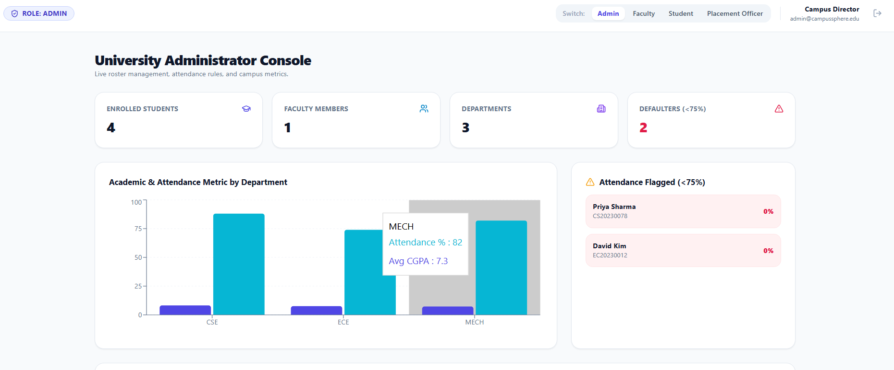
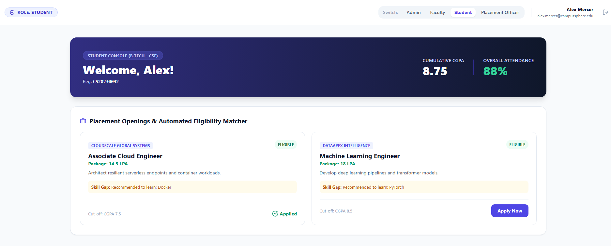
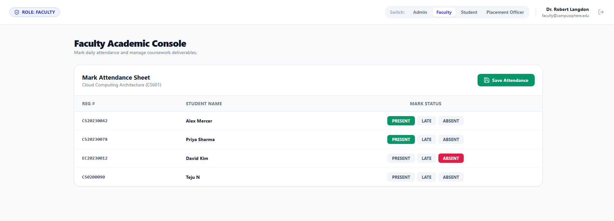
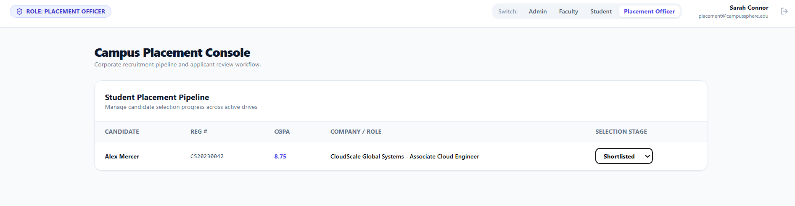
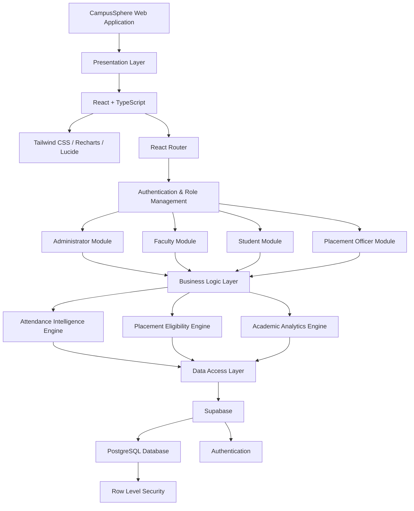
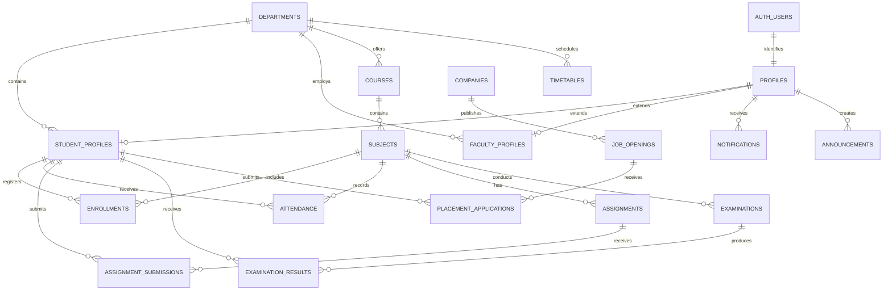
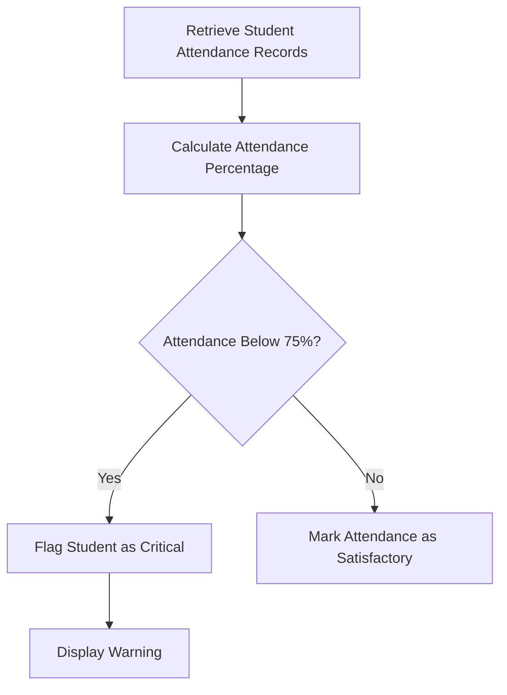
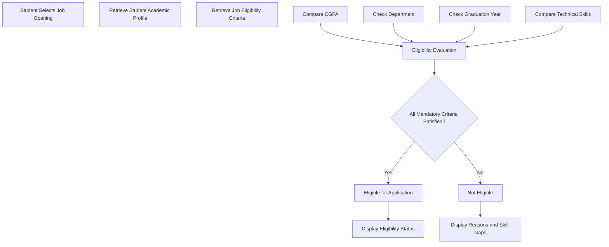

# 🎓 CampusSphere – Intelligent Campus Management Ecosystem

<div align="center">

### A Unified, Intelligent Platform for Modern Campus Administration

An integrated campus management ecosystem connecting Students, Faculty Members, Placement Officers, and University Administrators through a centralized digital platform.


[System Overview](#-system-overview) •
[Features](#-key-features) •
[Architecture](#-system-architecture) •
[Database](#-database-design--er-diagram) •
[Intelligent Engines](#-intelligent-engines) •
[Installation](#-installation--setup) •
[Testing](#-interactive-testing-guide)

</div>


---

# 📌 System Overview

**CampusSphere** is a centralized Intelligent Campus Management Ecosystem designed to simplify and modernize academic and administrative operations within educational institutions.

Traditional campus management often involves disconnected systems for student records, faculty management, attendance tracking, academic performance, assignments, and placement activities.

CampusSphere addresses this fragmentation by integrating these operations into one unified web application with role-based access and intelligent rule-based automation.

The platform provides dedicated dashboards for four major stakeholders:

- **Administrator:** Manages institutional records, departments, faculty, students, attendance, and academic activities.
- **Faculty:** Manages classes, attendance, assignments, assessments, and student performance.
- **Student:** Monitors academic progress, attendance, assignments, examinations, and placement opportunities.
- **Placement Officer:** Manages recruitment drives, eligibility requirements, student applications, and selection pipelines.

The system aims to improve transparency, operational efficiency, academic monitoring, and placement coordination.

## 🎯 Project Objectives

- Centralize campus-related information and academic activities.
- Reduce manual administrative work through automation.
- Improve attendance monitoring and student performance tracking.
- Simplify communication between students, faculty, and administrators.
- Automate placement eligibility evaluation.
- Provide actionable academic and placement insights.
- Maintain structured access control across different user roles.

---

# ✨ Key Features

## 1. Role-Based Access Control (RBAC)

CampusSphere provides four dedicated user roles with separate dashboards and permissions.

| Role | Primary Responsibilities |
|---|---|
| Administrator | Institutional management and monitoring |
| Faculty | Attendance, assignments, and academic assessment |
| Student | Academic tracking and placement applications |
| Placement Officer | Recruitment and placement coordination |

## 2. Administrator Module

- Student record management (Create, Read, Update, Delete).
- Faculty management.
- Department and course management.
- Institutional statistics and analytics.
- Attendance monitoring.
- Identification of attendance defaulters.
- Timetable management.
- Campus-wide announcements.
- Academic and placement reports.

## 3. Student Module

- Personalized student dashboard.
- Profile and academic information.
- Semester-wise CGPA visualization.
- Subject-wise attendance monitoring.
- Examination results.
- Weekly timetable.
- Assignment tracking and submissions.
- Upcoming examination information.
- Placement opportunities.
- Job eligibility evaluation.
- Placement application tracking.
- Notifications and announcements.

## 4. Faculty Module

- Faculty profile and assigned subject management.
- Student roster management.
- Daily attendance marking.
- Attendance status updates.
- Assignment creation and management.
- Assignment submission tracking.
- Internal assessment management.
- Student performance monitoring.
- Subject-related announcements.
- Teaching timetable.

## 5. Placement Officer Module

- Company registration and management.
- Job opportunity creation.
- Recruitment eligibility configuration.
- Minimum CGPA requirements.
- Department and graduation year restrictions.
- Required skill configuration.
- Eligible student identification.
- Student application management.
- Recruitment stage updates.
- Placement analytics and reporting.

## 6. Intelligent Campus Features

- Automated attendance defaulter detection.
- Rule-based placement eligibility evaluation.
- Skill gap identification.
- Academic performance monitoring.
- Placement readiness insights.
- Dynamic dashboard analytics.

---

# 📸 System Preview & Dashboards

Add screenshots of your actual application inside the `screenshots/` directory.

## 1. University Administrator Dashboard

Centralized institutional monitoring with student management, academic statistics, attendance analytics, and administrative operations.

<p align="center">
  
</p>

## 2. Student Dashboard

Personalized academic dashboard displaying attendance, CGPA progression, assignments, examinations, and placement opportunities.

<p align="center">
  
</p>

## 3. Faculty Dashboard

Academic workspace for attendance management, assignment creation, assessment tracking, and student performance monitoring.

<p align="center">
  
</p>

## 4. Placement Officer Dashboard

Recruitment management interface for company drives, job eligibility, candidate applications, and selection tracking.

<p align="center">
  
</p>

---

# 🛡️ Role-Based Access Control Matrix

The following matrix describes the intended access model.

| Module / Action | Administrator | Faculty | Student | Placement Officer |
|---|:---:|:---:|:---:|:---:|
| Manage student profiles | Full | View assigned | Own profile | View permitted |
| Manage faculty profiles | Full | Own profile | Restricted | Restricted |
| Manage departments | Full | View | View | Restricted |
| Manage courses | Full | Assigned courses | Enrolled courses | Restricted |
| Mark attendance | Monitor | Full | Restricted | Restricted |
| View attendance | All | Assigned classes | Own records | Restricted |
| Create assignments | Monitor | Full | Restricted | Restricted |
| Submit assignments | Monitor | Review | Full | Restricted |
| Manage examinations | Full | Assigned subjects | View results | Restricted |
| Publish announcements | Full | Subject-related | View | Placement-related |
| Create job openings | Monitor | Restricted | Restricted | Full |
| Evaluate job eligibility | Monitor | Restricted | View own | Full |
| Apply for jobs | Restricted | Restricted | Full if eligible | Monitor |
| Update selection stages | Monitor | Restricted | View own | Full |
| View placement analytics | Full | Restricted | Own status | Full |

**Security Note:** UI-level role restrictions should be complemented by server-side authorization and Supabase Row Level Security policies wherever Supabase is used.

---

# 🏗️ System Architecture

CampusSphere follows a modular, layered architecture that separates presentation, application logic, business rules, and data persistence.



## Architecture Components

| Layer | Responsibility |
|---|---|
| Presentation Layer | User interface and dashboards |
| Routing Layer | Navigation and protected routes |
| Authentication Layer | User identity and role management |
| Business Logic Layer | Academic and administrative workflows |
| Intelligence Layer | Attendance, eligibility, and performance rules |
| Data Access Layer | Database communication |
| Persistence Layer | PostgreSQL data storage |

---

# 🗄️ Database Design & ER Diagram

CampusSphere uses a relational database architecture designed to organize academic, administrative, and recruitment information.

The intended database structure uses primary keys, foreign key relationships, constraints, and Row Level Security (RLS) policies.

## 1. Entity Relationship Diagram



## 2. Database Schema & Key Columns

The following table summarizes the principal entities and their intended responsibilities.

| Table | Primary Key | Important Foreign Keys | Purpose |
|---|---|---|---|
| profiles | id (UUID) | auth.users(id) | User identity and role |
| departments | id (UUID) | None | Department catalog |
| student_profiles | id (UUID) | profile_id, department_id | Student academic information |
| faculty_profiles | id (UUID) | profile_id, department_id | Faculty information |
| courses | id (UUID) | department_id | Academic course catalog |
| subjects | id (UUID) | course_id | Subject information |
| enrollments | id (UUID) | student_id, subject_id | Student subject registration |
| attendance | id (UUID) | student_id, subject_id | Attendance records |
| assignments | id (UUID) | subject_id | Academic assignments |
| assignment_submissions | id (UUID) | assignment_id, student_id | Assignment submissions |
| examinations | id (UUID) | subject_id | Examination information |
| examination_results | id (UUID) | examination_id, student_id | Student results |
| timetables | id (UUID) | department_id | Class schedules |
| companies | id (UUID) | None | Recruiting companies |
| job_openings | id (UUID) | company_id | Job opportunities |
| placement_applications | id (UUID) | job_id, student_id | Recruitment applications |
| announcements | id (UUID) | created_by | Campus announcements |
| notifications | id (UUID) | user_id | User notifications |

*Note: The actual column names and relationships should match the SQL schema implemented in the repository.*

## 3. Important Database Constraints

Recommended constraints include:

- Unique registration numbers for students.
- Unique employee codes for faculty.
- Valid attendance statuses.
- Valid CGPA ranges.
- Unique student-subject enrollment combinations.
- Unique student-job application combinations.
- Foreign key integrity across academic and recruitment entities.
- Appropriate indexes for frequently queried records.

## 4. Row Level Security (RLS)

When using Supabase, database-level access policies should ensure that:

- Students access only their permitted academic records.
- Faculty access records associated with their assigned classes.
- Administrators access authorized institutional information.
- Placement officers access authorized recruitment information.
- Users cannot change their own roles or access privileges.

---

# 🧠 Intelligent Engines

CampusSphere incorporates deterministic business-rule engines to automate important academic and recruitment operations.

## 1. Automated Attendance Defaulter Alert Engine

The attendance engine continuously evaluates attendance records to identify students who fall below the institution's required attendance threshold.

### Mathematical Formula

Attendance percentage is calculated as:

\[
\text{Attendance Rate} =
\frac{\text{Sessions Attended}}
{\text{Total Sessions Conducted}}
\times 100
\]

### Configurable Threshold

Default threshold: **75%**

### Decision Logic



### Expected Actions

- Identify students with attendance below the threshold.
- Display warning indicators on authorized dashboards.
- Highlight attendance defaulters in the administrator console.
- Help students monitor their attendance.
- Support timely academic intervention.

## 2. Deterministic Placement Eligibility & Skill Gap Matcher

The placement eligibility engine evaluates whether a student satisfies the requirements of a particular job opening.

### Input Parameters

**Student Information**
- Current CGPA.
- Department.
- Graduation year.
- Technical skills.

**Job Requirements**
- Minimum CGPA.
- Eligible departments.
- Eligible graduation years.
- Required technical skills.

### Evaluation Pipeline



### Output

The system provides:

- Eligible or ineligible status.
- CGPA requirement comparison.
- Department eligibility information.
- Graduation year validation.
- Missing skill identification.
- Suggestions for improving technical skills.

The engine uses transparent, rule-based evaluation rather than opaque predictions.

## 3. Academic Performance Analytics Engine

The academic analytics engine organizes student performance information into meaningful visualizations.

### Features

- Semester-wise CGPA tracking.
- Subject-wise performance analysis.
- Academic progress visualization.
- Identification of declining performance trends.
- Comparison of internal assessment results.
- Academic performance summaries.

### Expected Benefits

- Helps students understand their academic progression.
- Supports faculty in monitoring student performance.
- Helps administrators identify students who may need additional academic support.

---

# 💻 Technology Stack

| Technology | Purpose |
|---|---|
| React 18 | Frontend application framework |
| TypeScript 5 | Type-safe development |
| Vite 5 | Development server and build tool |
| Tailwind CSS 3 | Responsive styling |
| React Router | Application navigation |
| Lucide React | Iconography |
| Recharts | Data visualization |
| React Context API | Shared application state |
| Supabase | Backend services and authentication |
| PostgreSQL | Relational database |
| SQL | Database queries and management |

---

# 📁 Project Directory Structure

The following is the intended logical organization. Adapt it to the actual repository structure.

```text
campussphere/
│
├── public/
│   └── assets/
│
├── screenshots/
│   ├── admin-dashboard.png
│   ├── student-dashboard.png
│   ├── faculty-dashboard.png
│   └── placement-dashboard.png
│
├── supabase/
│   ├── schema.sql
│   ├── seed.sql
│   └── migrations/
│
├── src/
│   │
│   ├── assets/
│   │
│   ├── types/
│   │   └── index.ts
│   │
│   ├── lib/
│   │   └── supabase.ts
│   │
│   ├── services/
│   │   ├── intelligenceEngine.ts
│   │   ├── attendanceService.ts
│   │   └── placementService.ts
│   │
│   ├── contexts/
│   │   └── AuthContext.tsx
│   │
│   ├── components/
│   │   ├── common/
│   │   ├── charts/
│   │   ├── forms/
│   │   └── layout/
│   │       ├── Navbar.tsx
│   │       └── DashboardLayout.tsx
│   │
│   ├── pages/
│   │   ├── admin/
│   │   │   └── AdminDashboard.tsx
│   │   ├── student/
│   │   │   └── StudentDashboard.tsx
│   │   ├── faculty/
│   │   │   └── FacultyDashboard.tsx
│   │   └── placement/
│   │       └── PlacementDashboard.tsx
│   │
│   ├── App.tsx
│   ├── main.tsx
│   └── index.css
│
├── .env.example
├── .gitignore
├── index.html
├── package.json
├── package-lock.json
└── README.md
```

---

# ⚙️ Installation & Setup

Follow these instructions to run CampusSphere locally.

## Prerequisites

Install the following tools before starting:

- Node.js v18 or higher.
- npm v9 or higher.
- Git.
- Visual Studio Code (recommended).
- A Supabase account, if using the Supabase backend.

Verify installation:

```bash
node -v
npm -v
git --version
```

## 1. Clone the Repository

```bash
git clone https://github.com/YOUR_USERNAME/CampusSphere.git
```

Navigate into the project:

```bash
cd CampusSphere
```

## 2. Install Dependencies

```bash
npm install
```

## 3. Configure Environment Variables

Create a `.env` file in the project root.

Example:

```env
VITE_SUPABASE_URL=your_supabase_project_url
VITE_SUPABASE_ANON_KEY=your_supabase_anon_key
```

Use the actual environment variable names expected by your application.

**Security:** Never expose your Supabase service role key or other private credentials in frontend environment variables or public repositories.

## 4. Configure Supabase

If Supabase is used:

1. Create a project in the Supabase dashboard.
2. Configure the PostgreSQL database.
3. Apply the database schema.
4. Configure the required authentication settings.
5. Apply appropriate Row Level Security policies.
6. Add your Supabase project URL and publishable/anonymous client key to `.env`.

## 5. Start the Development Server

```bash
npm run dev
```

Open your browser:

```text
http://localhost:5173
```

## 6. Create a Production Build

```bash
npm run build
```

To preview the production build:

```bash
npm run preview
```

---

# 🧪 Interactive Testing Guide

The following scenarios can be used to evaluate the application's four major roles.

Actual test accounts and sample records should be configured in the development environment.

## 1. Administrator Testing

**Scenario A: Student Management**

1. Log in as Administrator.
2. Open Student Management.
3. Select Enrol New Student.
4. Enter the required student information.
5. Save the student record.
6. Verify the updated student list.

**Scenario B: Attendance Monitoring**

1. Navigate to Attendance Analytics.
2. View the attendance defaulter list.
3. Identify students below the 75% threshold.
4. Verify their warning indicators.

**Scenario C: Institutional Analytics**

1. Open the Administrator Dashboard.
2. Review total student and faculty counts.
3. Inspect department-level analytics.
4. Review attendance and placement statistics.

## 2. Faculty Testing

**Scenario A: Attendance Management**

1. Log in as Faculty.
2. Open the assigned class roster.
3. Select the required subject.
4. Mark students as Present, Late, or Absent.
5. Save the attendance records.
6. Verify that the updated records appear correctly.

**Scenario B: Assignment Management**

1. Navigate to Assignments.
2. Create a new assignment.
3. Enter the title, description, and deadline.
4. Publish the assignment.
5. Review student submissions.

**Scenario C: Academic Assessment**

1. Open the assessment module.
2. Enter student marks.
3. Save assessment records.
4. Review subject-wise performance.

## 3. Student Testing

**Scenario A: Academic Monitoring**

1. Log in as Student.
2. View the personalized dashboard.
3. Check semester-wise CGPA.
4. Review subject-wise attendance.
5. Open the timetable.
6. View examination results.

**Scenario B: Attendance Alerts**

1. Navigate to Attendance.
2. Review the current attendance percentage.
3. Check warning indicators if attendance falls below 75%.

**Scenario C: Placement Eligibility**

1. Navigate to Placement Opportunities.
2. Browse available job openings.
3. Select a job.
4. Review the eligibility evaluation.
5. Check missing requirements if ineligible.
6. Apply for a qualifying opportunity.
7. Track the application status.

## 4. Placement Officer Testing

**Scenario A: Company Management**

1. Log in as Placement Officer.
2. Open Company Management.
3. Add a recruiting company.
4. Save company information.

**Scenario B: Job Posting**

1. Navigate to Job Openings.
2. Create a new recruitment drive.
3. Enter minimum CGPA.
4. Configure eligible departments.
5. Set the graduation year.
6. Add required skills.
7. Publish the opportunity.

**Scenario C: Candidate Management**

1. Open the Student Placement Pipeline.
2. View applications.
3. Review student eligibility.
4. Update selection stages.
5. Track selected and rejected candidates.
6. Review recruitment statistics.

---

# 🔐 Security Considerations

CampusSphere is designed with the following security considerations:

- Role-based authorization.
- Protected application routes.
- Secure authentication.
- Database-level access policies.
- Input validation.
- Environment-based configuration.
- Restricted access to sensitive records.
- Secure handling of application credentials.

When using Supabase, configure and test Row Level Security for every table containing sensitive information.

---

# 🚀 Future Enhancements

Potential improvements for future versions include:

1. **AI-Based Academic Recommendations:** Personalized learning recommendations based on academic performance.
2. **AI Resume Analysis:** Automated resume parsing and job-skill matching.
3. **Advanced Placement Prediction:** Statistical models for placement readiness analysis.
4. **Smart Timetable Optimization:** Automated timetable generation with faculty and classroom constraints.
5. **Email and SMS Notifications:** Automated communication for attendance, assignments, and recruitment.
6. **Document Verification:** Secure digital student document management.
7. **Mobile Application:** Dedicated Android and iOS applications.
8. **Cloud Deployment:** Scalable cloud infrastructure and automated deployment.
9. **Advanced Reporting:** Exportable PDF and Excel analytics.
10. **AI Campus Assistant:** Conversational assistant for campus-related queries.

---

# 📈 Expected Project Impact

CampusSphere aims to provide measurable operational benefits:

| Stakeholder | Expected Benefit |
|---|---|
| Students | Better academic visibility and placement tracking |
| Faculty | Simplified attendance and academic management |
| Administrators | Centralized institutional monitoring |
| Placement Officers | Efficient recruitment coordination |
| Institution | Improved data organization and transparency |

---

# 👩‍💻 Development & Contributions

CampusSphere is a final-year Computer Science and Engineering major project.

Contributions, suggestions, bug reports, and feature improvements are welcome.

To contribute:

1. Fork the repository.
2. Create a feature branch.
3. Implement your changes.
4. Test the functionality.
5. Submit a pull request.

---

# 📄 License

This project is distributed under the MIT License.

If you choose this license, include a `LICENSE` file in the repository.

---

<div align="center">

### 🎓 CampusSphere

**Connecting Campus. Simplifying Management. Empowering Students.**

*An Intelligent Campus Management Ecosystem*

</div>
